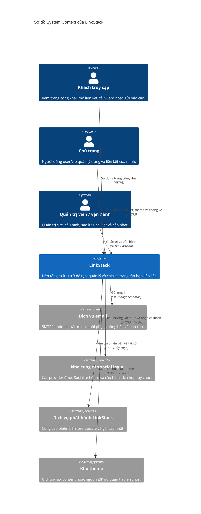
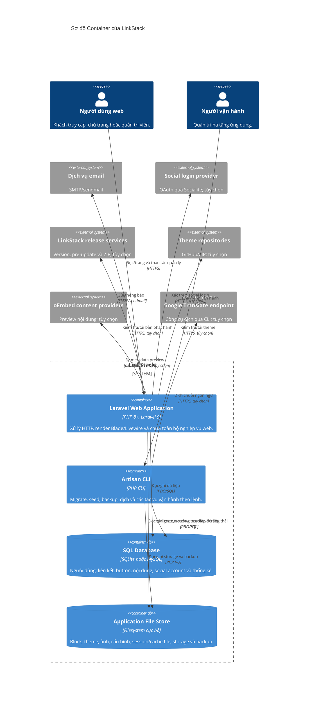
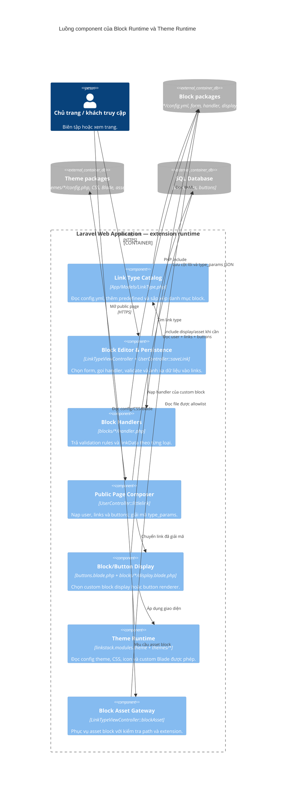
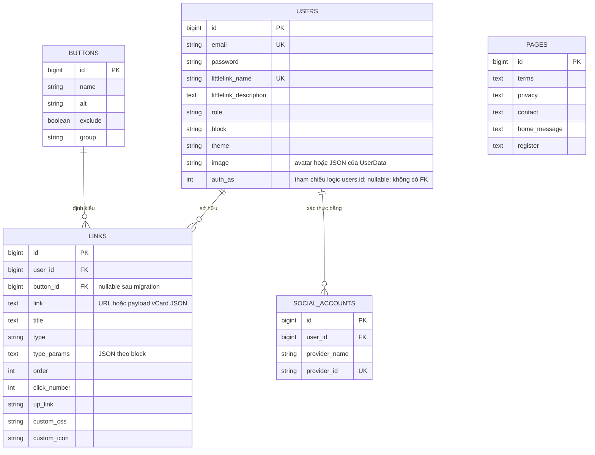
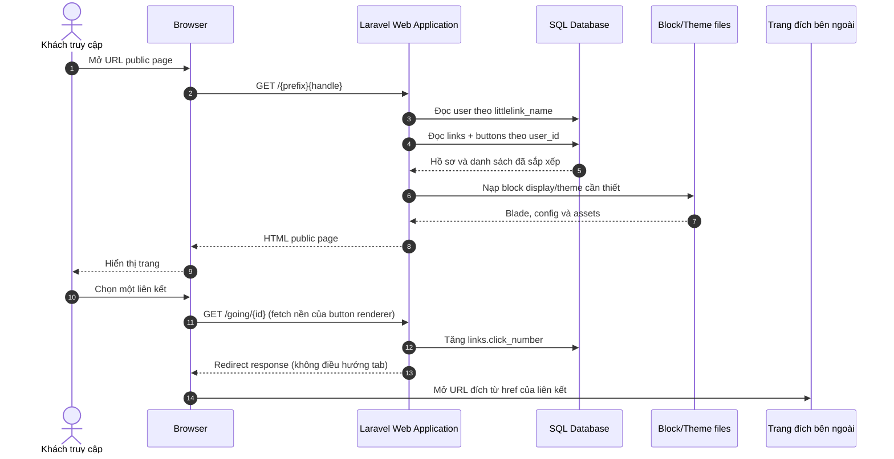
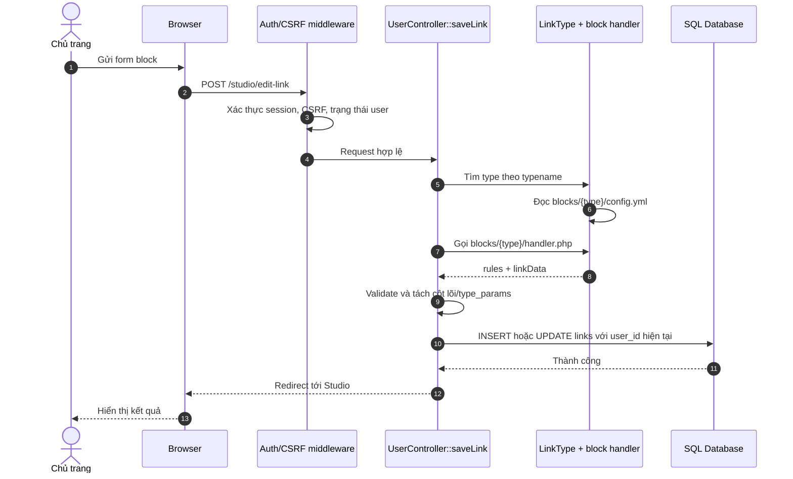
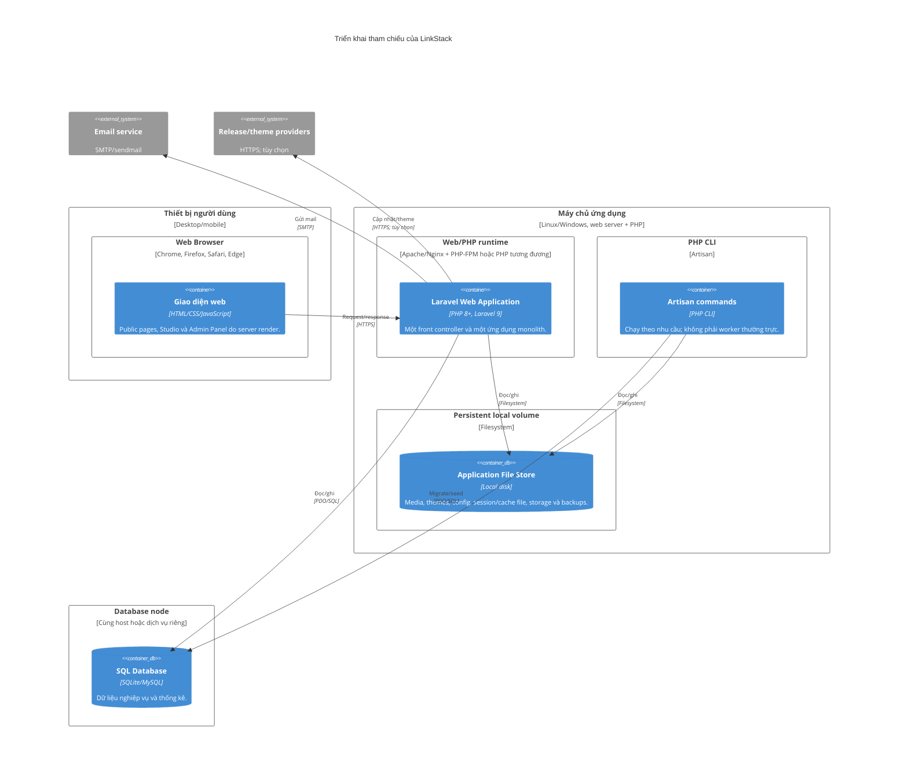

# Thiết kế kiến trúc C4 — LinkStack

> **Mốc mã nguồn:** LinkStack 4.8.8, commit `35d8205f017014f457f517d3a3285bdc82f151d5` 
> **Phạm vi:** kiến trúc hiện tại (*as-is*) được suy ra từ mã nguồn, không phải thiết kế microservices hay kiến trúc mục tiêu. 
> **Cập nhật:** 2026-11-01

## 1. Mục đích và quy ước

Tài liệu này mô tả LinkStack theo bốn mức của mô hình C4:

1. **System Context:** ai sử dụng LinkStack và hệ thống tương tác với những hệ thống bên ngoài nào.
2. **Containers:** các đơn vị chạy hoặc lưu trữ dữ liệu cấu thành LinkStack.
3. **Components:** các trách nhiệm bên trong ứng dụng Laravel và cơ chế mở rộng block/theme.
4. **Code:** ánh xạ component về lớp, thư mục và mô hình dữ liệu thực tế.

Các sơ đồ động và triển khai ở cuối tài liệu là sơ đồ bổ trợ cho C4. Trong tài liệu này:

- **Container** là khái niệm C4, không đồng nghĩa với Docker container.
- Nhãn **“tùy chọn”** chỉ tích hợp hoặc hạ tầng không bắt buộc cho luồng lõi.
- Một component là ranh giới trách nhiệm logic trong monolith, **không** phải một dịch vụ triển khai độc lập.
- Các đề xuất ở mục 10 chưa được hiện thực và không được dùng để diễn giải hành vi hiện tại.

## 2. Tổng quan kiến trúc

| Khía cạnh | Thiết kế hiện tại |
| --- | --- |
| Kiểu kiến trúc | **Modular monolith** render phía máy chủ; một ứng dụng Laravel đảm nhiệm public site, Studio, Admin Panel và các endpoint nội bộ. |
| Runtime | PHP `>=8.0`, Laravel `^9.52.4`; front controller là `index.php`. |
| Giao diện | Blade, Livewire 2, JavaScript/CSS; không có SPA hoặc API backend tách riêng. |
| Nghiệp vụ lõi | Trang liên kết công khai, quản lý hồ sơ/liên kết/theme, theo dõi click, quản trị người dùng và nội dung site. |
| Mở rộng | Block được khai báo bằng YAML và hiện thực bằng PHP/Blade trong `blocks/`; theme nằm trong `themes/`. |
| Dữ liệu | Eloquent/Query Builder với SQL database; SQLite hoặc MySQL là hai lựa chọn được installer hỗ trợ trực tiếp. |
| Tệp và cấu hình | Filesystem cục bộ lưu ảnh, theme, cache/session mặc định, bản sao lưu và các marker cài đặt/cập nhật. |
| Xử lý nền | `QUEUE_CONNECTION=sync` theo cấu hình mẫu; scheduler hiện không có tác vụ. Mail, backup và update được kích hoạt đồng bộ. |
| API | `routes/api.php` chỉ còn route khung `/api/user`; hệ thống không được thiết kế theo hướng API-first. |

## 3. C4 mức 1 — System Context

### 3.1 Trách nhiệm theo tác nhân

| Tác nhân | Trách nhiệm và ranh giới |
| --- | --- |
| Khách truy cập | Chỉ sử dụng các route công khai; không cần tài khoản để xem trang. Một số route công khai dùng `disableCookies` để tránh tạo session cookie mới. |
| Chủ trang | Sau xác thực, quản lý liên kết và hồ sơ thuộc quyền sở hữu của mình. Middleware `link-id` kiểm tra quyền sở hữu ở các route liên quan. |
| Quản trị viên | Có thêm quyền quản lý người dùng, nội dung site, cấu hình, theme, backup và update. Middleware `admin` kiểm tra `users.role = admin`. |
| Người vận hành | Có thể dùng Artisan để migrate/seed, sao lưu hoặc bảo trì. Quyền này thuộc hạ tầng, không phải một vai trò nghiệp vụ riêng trong bảng `users`. |

### 3.2 Hệ thống bên ngoài

| Hệ thống | Mục đích | Khi không khả dụng |
| --- | --- | --- |
| Email | Xác minh địa chỉ, đặt lại mật khẩu, thông báo đăng ký, gửi báo cáo và email kiểm tra cấu hình. | Các luồng xem/trang quản lý cốt lõi vẫn có thể chạy; tính năng cần email bị gián đoạn. |
| Social login | Đăng nhập qua provider bằng Socialite. | Đăng nhập bằng email/mật khẩu vẫn là luồng chính. |
| Dịch vụ phát hành | Kiểm tra phiên bản, tải pre-update và ZIP cập nhật. | Ứng dụng hiện tại tiếp tục chạy; không cập nhật tự động được. |
| Kho theme | Kiểm tra phiên bản và tải theme từ nguồn bên ngoài. | Theme đã cài vẫn dùng được; quản trị viên có thể tải ZIP thủ công. |
| Nội dung oEmbed | Lấy thumbnail khi Studio hiển thị loại liên kết video tương thích. | Chỉ ảnh hưởng phần preview liên quan; không phải phụ thuộc của public page lõi. |

## 4. C4 mức 2 — Containers

### 4.1 Mô tả container

| Container | Trách nhiệm | Công nghệ và dữ liệu chính |
| --- | --- | --- |
| Laravel Web Application | Public pages, xác thực, Studio, Admin Panel, import/export, tracking, installer và updater. | `routes/`, `app/Http/`, `app/Models/`, `resources/views/`, `blocks/`, `themes/`. |
| Artisan CLI | Vận hành theo lệnh; không phải daemon luôn chạy trong thiết kế hiện tại. | `artisan`, `app/Console/`; schedule trong `app/Console/Kernel.php` đang để trống. |
| SQL Database | Nguồn dữ liệu quan hệ cho tài khoản, trang, link, button và thống kê. | Các bảng trong `database/migrations/`; `laravel-visits` dùng Eloquent engine. |
| Application File Store | Code mở rộng và dữ liệu không quan hệ; một phần được ghi trực tiếp trong request web. | `assets/img/`, `assets/favicon/icons/`, `themes/`, `storage/`, `backups/`, `.env`, `config/advanced-config.php`. |

### 4.2 Ranh giới triển khai và trạng thái

- Web server chuyển request không khớp file tĩnh vào `index.php`; Apache rewrite đã có sẵn trong `.htaccess`. Các web route được nạp qua nhóm middleware `web`.
- Blade được render trong tiến trình Laravel. JavaScript và Livewire chạy trên browser nhưng **không tạo thành một frontend container độc lập**.
- Session và cache mặc định dùng file. Redis có cấu hình và helper hỗ trợ, nhưng không phải dependency bắt buộc của topology mặc định.
- Database có thể nằm cùng máy (SQLite) hoặc tách máy (MySQL). Cấu hình Laravel còn khai báo PostgreSQL/SQL Server nhưng tài liệu này không xem các lựa chọn đó là đã được installer và kiểm thử của dự án xác nhận.
- Filesystem là stateful: media, theme, `.env`, backup và một số marker nằm ngoài SQL database. Do đó chỉ sao chép database là chưa đủ để khôi phục một instance.
- Các thao tác update/backup có thể ghi vào cây mã nguồn. Đây là yêu cầu triển khai hiện tại, không phải một immutable deployment thông thường.

## 5. C4 mức 3 — Components

### 5.1 Các component trong Laravel Web Application

```mermaid
C4Component
title Sơ đồ Component của Laravel Web Application

Person(client, "Người dùng", "Khách truy cập, chủ trang hoặc quản trị viên.")

Container_Boundary(webBoundary, "Laravel Web Application") {
    Component(http, "HTTP Routing & Middleware", "Routes, Kernel, middleware", "Điều phối request, CSRF, session, xác thực và phân quyền.")
    Component(identity, "Identity & Access", "Auth controllers, Socialite", "Đăng ký, đăng nhập, xác minh, khôi phục và social login.")
    Component(publicPage, "Public Profile & Tracking", "UserController, HomeController", "Render trang công khai, redirect, vCard và click counter.")
    Component(studio, "Studio & Profile", "UserController", "Quản lý link, hồ sơ, theme, icon, import/export và thống kê.")
    Component(administration, "Administration", "AdminController, Livewire UserTable", "Quản lý người dùng, nội dung, cấu hình và impersonation.")
    Component(blockRuntime, "Block Runtime", "LinkType, LinkTypeViewController, blocks", "Khám phá loại link, tạo form, validate, xử lý và render block.")
    Component(presentation, "Presentation & Theme", "Blade, theme config, assets", "Dựng layout public/studio/admin và áp dụng theme.")
    Component(operations, "Install, Backup & Update", "InstallerController, updater views, Artisan", "Cài đặt, cấu hình, sao lưu và thay thế mã nguồn khi cập nhật.")
    Component(dataAccess, "Data Access", "Eloquent, Query Builder, UserData", "Truy cập dữ liệu quan hệ và cache dữ liệu người dùng.")
    Component(integration, "External Integration", "Mail, Socialite, HTTP client, oEmbed", "Cách ly các lời gọi tới dịch vụ bên ngoài.")
}

ContainerDb_Ext(db, "SQL Database", "SQLite/MySQL")
ContainerDb_Ext(files, "Application File Store", "Block, theme, media, config và backup")
System_Ext(mailService, "Email", "SMTP/sendmail")
System_Ext(socialProvider, "Social login", "Tùy chọn")
System_Ext(releaseService, "Release services", "Tùy chọn")
System_Ext(embedProvider, "oEmbed provider", "Tùy chọn")

Rel(client, http, "Gửi request", "HTTPS")
Rel(http, identity, "Route auth và kiểm tra truy cập")
Rel(http, publicPage, "Route công khai")
Rel(http, studio, "Route /studio")
Rel(http, administration, "Route /admin và /dashboard")
Rel(http, operations, "Route installer/update/backup")
Rel(identity, dataAccess, "Đọc/ghi tài khoản")
Rel(publicPage, dataAccess, "Đọc trang và tăng click")
Rel(studio, dataAccess, "Đọc/ghi dữ liệu sở hữu")
Rel(administration, dataAccess, "Quản trị dữ liệu")
Rel(dataAccess, db, "Eloquent / SQL")
Rel(dataAccess, files, "Cache file khi được cấu hình")
Rel(publicPage, blockRuntime, "Render item theo type")
Rel(studio, blockRuntime, "Lấy form và xử lý block")
Rel(publicPage, presentation, "Render public page")
Rel(studio, presentation, "Render Studio")
Rel(administration, presentation, "Render Admin Panel")
Rel(blockRuntime, files, "Đọc YAML/PHP/Blade")
Rel(presentation, files, "Đọc theme và assets")
Rel(operations, files, "Ghi config, backup và gói cập nhật")
Rel(operations, db, "Migrate/seed")
Rel(identity, integration, "Gửi notification và social login")
Rel(publicPage, integration, "Gửi báo cáo")
Rel(studio, integration, "Lấy preview oEmbed")
Rel(operations, integration, "Tải thông tin phát hành")
Rel(integration, mailService, "Email")
Rel(integration, socialProvider, "OAuth")
Rel(integration, releaseService, "HTTPS")
Rel(integration, embedProvider, "HTTPS")
```

**Điểm cần đọc đúng:** sơ đồ trên phân tách trách nhiệm để tài liệu hóa; mã nguồn hiện vẫn có các controller lớn và logic vận hành trong Blade. `External Integration` là nhóm các adapter do Laravel/vendor cung cấp, chưa phải một lớp facade chung do LinkStack định nghĩa.

### 5.2 Component mở rộng block và theme

#### Quy tắc mở rộng hiện tại

1. `LinkType::get()` quét từng thư mục con của `blocks/` và đọc `config.yml`; loại `predefined` được thêm bằng mã.
2. Form block được phục vụ qua `LinkTypeViewController`; namespace Blade `blocks::` trỏ tới thư mục `blocks/`.
3. Với `predefined` và `link`, `UserController::saveLink()` xử lý trực tiếp. Với custom block khác, controller nạp `handler.php`, nhận `rules` và `linkData`, rồi validate.
4. Các khóa trùng cột của bảng `links` được lưu thành cột; phần dữ liệu riêng còn lại được gom vào `links.type_params` dưới dạng JSON.
5. Khi render public page, `type_params` được giải mã và merge vào đối tượng link. `custom_html` chọn `blocks::<type>.display`; các trường hợp còn lại đi qua button renderer.
6. Theme được chọn theo `users.theme`; config PHP, CSS và các đoạn Blade tùy chọn trong `themes/` quyết định cách hiển thị.
7. Block và theme có thể chứa PHP/Blade. Vì vậy chúng là **trusted code extensions**, không phải plugin dữ liệu chạy trong sandbox.

## 6. C4 mức 4 — Code và dữ liệu

### 6.1 Bản đồ component về mã nguồn

| Component | Vị trí hiện thực chính |
| --- | --- |
| HTTP Routing & Middleware | [`routes/web.php`](../../routes/web.php), [`routes/auth.php`](../../routes/auth.php), [`routes/home.php`](../../routes/home.php), [`app/Http/Kernel.php`](../../app/Http/Kernel.php), [`app/Http/Middleware/`](../../app/Http/Middleware/) |
| Identity & Access | [`app/Http/Controllers/Auth/`](../../app/Http/Controllers/Auth/), [`app/Models/User.php`](../../app/Models/User.php), [`app/Models/SocialAccount.php`](../../app/Models/SocialAccount.php) |
| Public Profile & Tracking | [`UserController::littlelink()`](../../app/Http/Controllers/UserController.php), [`UserController::clickNumber()`](../../app/Http/Controllers/UserController.php), [`UserController::vcard()`](../../app/Http/Controllers/UserController.php), [`app/Http/Controllers/HomeController.php`](../../app/Http/Controllers/HomeController.php) |
| Studio & Profile | Các method còn lại của [`app/Http/Controllers/UserController.php`](../../app/Http/Controllers/UserController.php) và [`resources/views/studio/`](../../resources/views/studio/) |
| Administration | [`app/Http/Controllers/AdminController.php`](../../app/Http/Controllers/AdminController.php), [`app/Http/Controllers/Admin/LinkTypeController.php`](../../app/Http/Controllers/Admin/LinkTypeController.php), [`app/Http/Livewire/UserTable.php`](../../app/Http/Livewire/UserTable.php) |
| Block Runtime | [`app/Models/LinkType.php`](../../app/Models/LinkType.php), [`app/Http/Controllers/LinkTypeViewController.php`](../../app/Http/Controllers/LinkTypeViewController.php), [`blocks/`](../../blocks/) |
| Presentation & Theme | [`resources/views/linkstack/`](../../resources/views/linkstack/), [`resources/views/layouts/`](../../resources/views/layouts/), [`themes/`](../../themes/), [`assets/`](../../assets/) |
| Install, Backup & Update | [`app/Http/Controllers/InstallerController.php`](../../app/Http/Controllers/InstallerController.php), [`resources/views/update.blade.php`](../../resources/views/update.blade.php), [`resources/views/backup.blade.php`](../../resources/views/backup.blade.php), [`config/backup.php`](../../config/backup.php) |
| Data Access | [`app/Models/`](../../app/Models/), [`database/migrations/`](../../database/migrations/), [`app/Functions/functions.php`](../../app/Functions/functions.php) |
| External Integration | [`config/mail.php`](../../config/mail.php), [`config/services.php`](../../config/services.php), [`resources/views/update.blade.php`](../../resources/views/update.blade.php), [`app/Console/Commands/Translate.php`](../../app/Console/Commands/Translate.php) |

### 6.2 Mô hình dữ liệu lõi

Các quy ước dữ liệu quan trọng:

- `users` chứa cả tài khoản và hồ sơ public page; vai trò `user`, `vip`, `admin` nằm trên cùng một bảng.
- `links.user_id` và `links.button_id` là quan hệ vật lý chính. `order`, `up_link`, `type` và `type_params` quyết định thứ tự/cách render.
- `links.link` là dữ liệu đa dụng: thường là URL nhưng với vCard có thể chứa JSON. Cần kiểm tra `type`/button trước khi diễn giải.
- `UserData` hiện dùng lại bảng `users` và cột `image` để lưu map JSON cho các tùy chọn như checkmark/share/new-tab; đây là một điểm ghép trách nhiệm trong thiết kế hiện tại.
- `pages` được dùng như bản ghi cấu hình/nội dung chung của site, không phải trang của từng người dùng.
- `visits` là kho thống kê logic của `laravel-visits` (Eloquent engine); không có FK trực tiếp tới `users` nên không thể hiện như quan hệ vật lý trong sơ đồ.
- Migration cũ tạo bảng `link_types`, nhưng `app/Models/LinkType.php` hiện lấy danh mục từ `blocks/*/config.yml`. **Không dùng bảng này làm nguồn sự thật runtime trong tài liệu kiến trúc.**
- `password_resets`, `failed_jobs` và metadata migration là bảng hạ tầng Laravel, không thuộc mô hình nghiệp vụ lõi.

## 7. Các luồng động bổ trợ

### 7.1 Xem public page và ghi nhận click

Ghi chú:

- Prefix public page thay đổi theo `custom_url_prefix`; route cũng hỗ trợ `/@{handle}` và custom domain.
- Với button renderer hiện tại, URL đích nằm trực tiếp trong `href`; `/going/{id}` chủ yếu phục vụ tracking bằng fetch. Một số renderer khác hoặc route trực tiếp có thể dùng response redirect.
- Trang bị chặn (`users.block = yes`) trả 404. vCard có endpoint tải riêng và cũng tăng click counter.
- `visits` phục vụ số liệu dashboard; không đồng nhất counter này với `links.click_number`.

### 7.2 Tạo hoặc sửa một custom block link

`predefined` và `link` đi qua nhánh xử lý trực tiếp trong controller, nên không gọi handler như bước 6–7. Khi sửa, controller và/hoặc middleware phải bảo đảm link thuộc về người dùng hiện tại.

### 7.3 Cập nhật và sao lưu

Luồng updater hiện tại gồm các bước điều hướng bằng query string trong cùng route `/update`:

1. Kiểm tra phiên bản local và version/beta service.
2. Nếu không bỏ backup, gọi Artisan `backup:clean` và `backup:run --only-files`; tạo marker `backups/CANUPDATE`.
3. Tải nội dung pre-update, ghi vào `resources/views/components/pre-update.blade.php` và thực thi như một Blade include.
4. Tải ZIP từ update/beta service rồi giải nén trực tiếp vào `base_path()`.
5. Chạy `components/finishing.blade.php` để cập nhật cấu hình/dữ liệu và hoàn tất; bật lại site khỏi maintenance mode.

Toàn bộ chuỗi này là tác vụ đồng bộ do request web điều khiển, cần quyền ghi rộng trên filesystem và phụ thuộc vào nguồn phát hành.

## 8. Sơ đồ triển khai bổ trợ

### 8.1 Hai topology được mã nguồn hỗ trợ trực tiếp

| Topology | Đặc điểm | Điểm cần kiểm soát |
| --- | --- | --- |
| Single-node với SQLite | Web/PHP, CLI, SQLite file và application files cùng một persistent volume. | Backup phải bao gồm cả database file và application state; giới hạn ghi của SQLite; quyền truy cập file. |
| Web node + MySQL | Web/PHP và local files trên app node; MySQL có thể tách node. | Backup MySQL riêng; kết nối/TLS tới DB; session/cache/file vẫn local nếu chưa cấu hình lại. |

Topology tham chiếu là **một web replica**. Chạy nhiều replica đòi hỏi thiết kế bổ sung cho session, cache, media/theme, marker và backup dùng chung; không được suy ra rằng hệ thống hiện đã stateless.

## 9. Yêu cầu chất lượng và ranh giới an toàn

| Thuộc tính | Cơ chế hiện tại | Hệ quả kiến trúc |
| --- | --- | --- |
| Bảo mật request | Session auth, CSRF, signed/throttled verification routes, role middleware, ownership middleware. | Mọi route mới phải đi qua nhóm middleware phù hợp; không dựa riêng vào ẩn nút ở UI. |
| Privacy của public page | `disableCookies` chuyển session sang array và loại `Set-Cookie` nếu chưa có session/XSRF cookie. | Không thêm tracking bằng session vào public route mà không đánh giá lại hành vi này. |
| Dữ liệu nhạy cảm | `.env` chứa cấu hình bí mật; `.htaccess` chặn dotfile, SQLite, ZIP và log. | Web server phải giữ các rule tương đương; không expose `database/`, `storage/`, `backups/` hay `.env`. |
| Mở rộng | Theme/block có thể chứa PHP/Blade; custom code trong theme chịu thêm cấu hình cho phép. | Chỉ cài package tin cậy; kiểm soát nguồn ZIP và quyền ghi thư mục. |
| Sẵn sàng phục hồi | Spatie Laravel Backup, local `backups/`, export JSON cho người dùng. | Export của user không thay thế backup toàn instance; backup local không thay thế bản sao off-site. |
| Hiệu năng | Cache file/Redis tùy chọn, thư mục assets có fingerprint cache, SQL queries trực tiếp. | Khi tăng tải cần đo query/render và thống nhất cache/session trước khi mở rộng replica. |
| Khả năng vận hành | Installer/update qua web, Artisan CLI, log Laravel. | Update là thao tác có đặc quyền cao và cần cơ chế rollback/kiểm chứng gói phát hành. |

**Lưu ý về backup:** `config/backup.php` khai báo nguồn file `base_path()` và SQLite, nhưng updater gọi `backup:run --only-files`, tức bỏ qua bước database dump. Với SQLite, file database nằm trong `base_path()` vẫn có thể được đóng gói như một file trong archive; cần kiểm tra nội dung archive và tính nhất quán của file khi khôi phục. MySQL không nằm trong cây source nên không được bao gồm. Vì vậy cần một quy trình backup/restore riêng, không được suy ra rằng mọi database đều đã được updater sao lưu đầy đủ.

## 10. Quyết định duy trì và hướng cải tiến

### 10.1 Quyết định cần giữ nhất quán

1. **Giữ một monolith cho đến khi có driver kiến trúc rõ ràng.** Các ranh giới trong tài liệu nên được củng cố bằng module/application service, không tách thành network service chỉ vì sơ đồ có nhiều component.
2. **`blocks/*/config.yml` là nguồn danh mục block runtime.** Thay đổi contract cần cập nhật cả catalog, form, handler, display và lược đồ `type_params`.
3. **SQL và filesystem cùng là nguồn state.** Mọi thiết kế backup, migration hoặc scaling phải tính cả hai.
4. **Public rendering và Studio dùng chung contract block.** Không sửa payload của handler mà không kiểm tra tương thích dữ liệu đã lưu.
5. **Tích hợp bên ngoài là tùy chọn trừ database/filesystem.** Public page lõi không nên phụ thuộc vào release service, social login hoặc oEmbed.

### 10.2 Hướng cải tiến đề xuất — chưa hiện thực

| Ưu tiên | Vấn đề hiện tại | Hướng cải tiến không làm thay đổi ranh giới C4 lõi |
| --- | --- | --- |
| Cao | Controller lớn; updater/pre-update/finishing chứa logic thực thi trong Blade. | Tách application services cho link/profile/admin; tách update/backup thành service hoặc command có kiểm thử, giữ Blade chỉ render. |
| Cao | Update giải nén vào cây source; backup updater chỉ file; rollback thủ công. | Kiểm chứng nguồn/gói, staging và atomic release; backup database riêng, lưu off-site và kiểm thử restore. |
| Cao | Import xóa rồi tạo lại toàn bộ links của user trong nhiều thao tác. | Bọc import trong database transaction và validate toàn bộ payload trước khi thay dữ liệu. |
| Trung bình | Mail, oEmbed, backup và update chạy đồng bộ. | Đưa tác vụ chậm sang queue/scheduler có worker giám sát; giữ fallback đồng bộ cho cài đặt nhỏ nếu cần. |
| Trung bình | Local session/cache/media/theme khiến app có trạng thái. | Chuẩn hóa shared storage và session/cache tập trung trước khi triển khai nhiều replica. |
| Trung bình | `UserData` dùng cột `users.image` cho JSON; `links.link` chứa nhiều loại payload. | Định nghĩa schema rõ cho settings và từng block; migration tương thích ngược trước khi tách cột/bảng. |
| Trung bình | Tồn tại cả migration `link_types` và catalog file mới. | Đánh dấu dữ liệu legacy, tài liệu hóa đường di cư và tránh để hai nguồn cùng được sửa runtime. |
| Nền tảng | Chưa có test suite trong cây source tại mốc mã nguồn. | Bổ sung test cho quyền sở hữu, public rendering, contract block, import/export và các đường vận hành quan trọng. |

## 11. Nguồn đối chiếu và bảo trì tài liệu

Kiến trúc được đối chiếu chủ yếu từ:

- [`composer.json`](../../composer.json) và [`package.json`](../../package.json): runtime và thư viện chính.
- [`routes/web.php`](../../routes/web.php), [`routes/auth.php`](../../routes/auth.php), [`routes/home.php`](../../routes/home.php): ranh giới public/Studio/Admin và installer.
- [`app/Http/Controllers/`](../../app/Http/Controllers/), [`app/Models/`](../../app/Models/), [`app/Http/Middleware/`](../../app/Http/Middleware/): trách nhiệm ứng dụng và kiểm soát truy cập.
- [`blocks/`](../../blocks/), [`themes/`](../../themes/), [`resources/views/linkstack/`](../../resources/views/linkstack/): extension contract và presentation.
- [`database/migrations/`](../../database/migrations/), [`config/database.php`](../../config/database.php), [`config/filesystems.php`](../../config/filesystems.php): persistence.
- [`resources/views/update.blade.php`](../../resources/views/update.blade.php), [`config/backup.php`](../../config/backup.php), [`app/Console/Kernel.php`](../../app/Console/Kernel.php): vận hành và xử lý nền.

Khi thay đổi route/container, ownership, block contract, nơi lưu state hoặc luồng update, cần cập nhật sơ đồ tương ứng và mốc mã nguồn ở đầu tài liệu. Không thêm hệ thống bên ngoài vào C4 chỉ vì một package tồn tại trong `composer.json`; chỉ thêm khi mã nguồn có luồng sử dụng thực tế.
